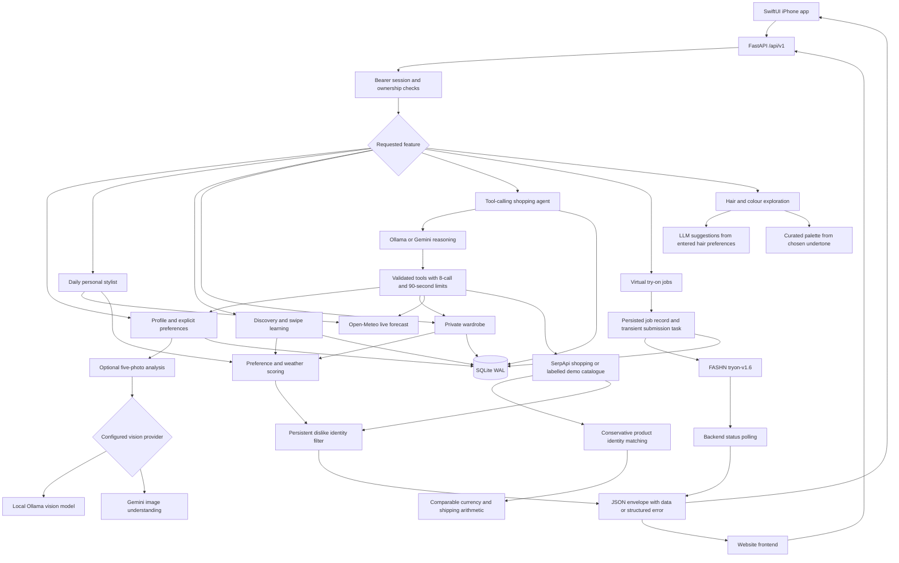
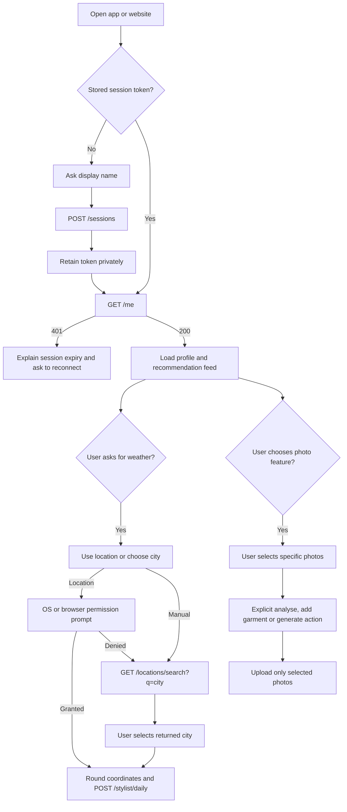
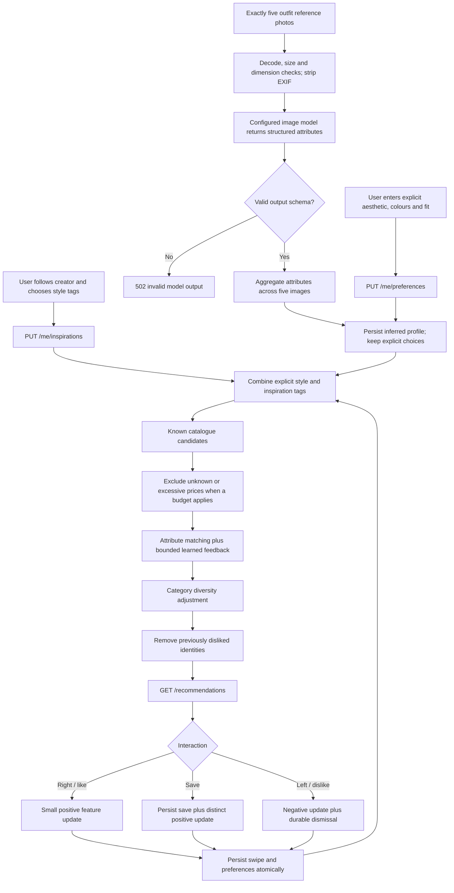
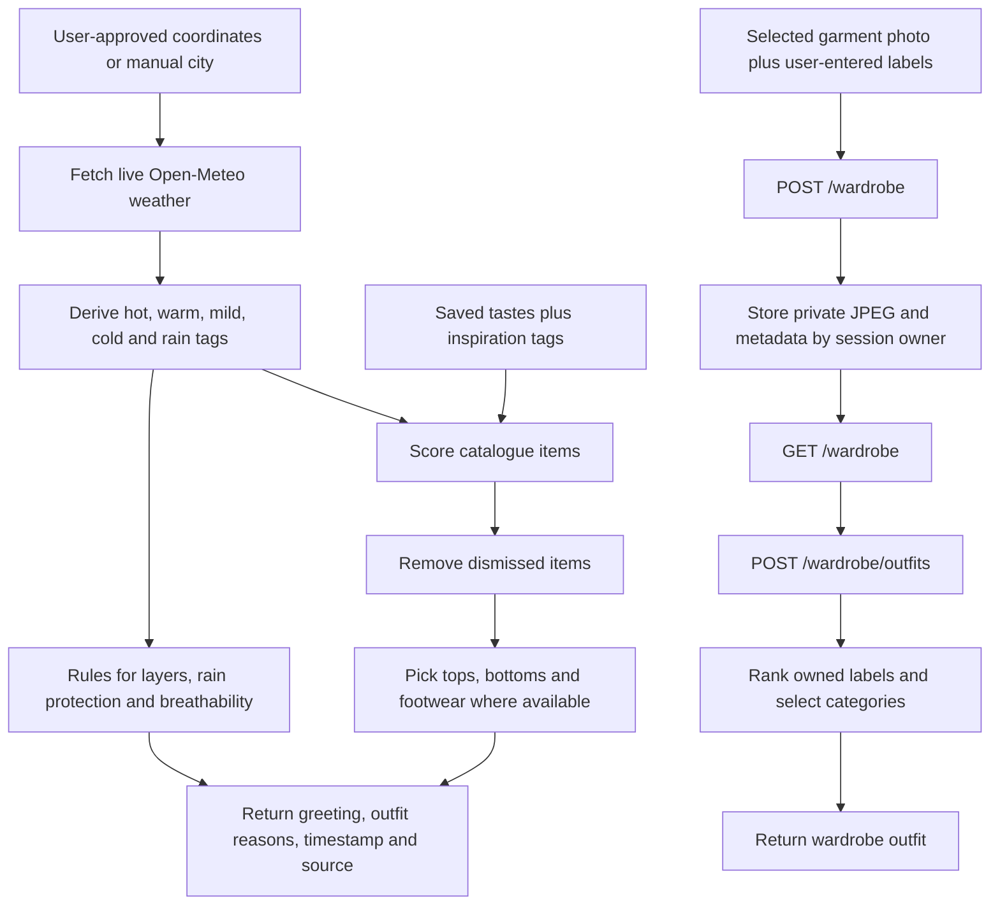
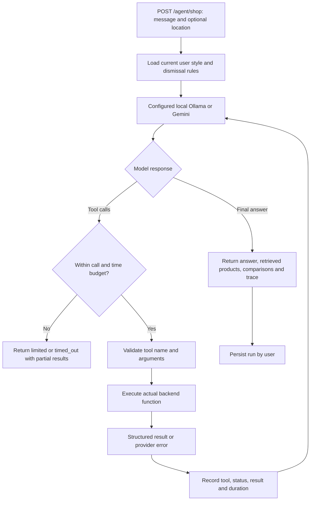
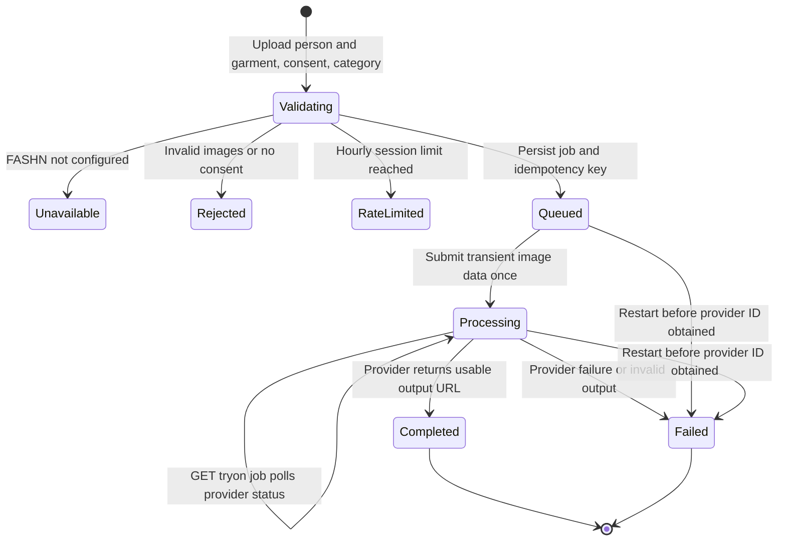
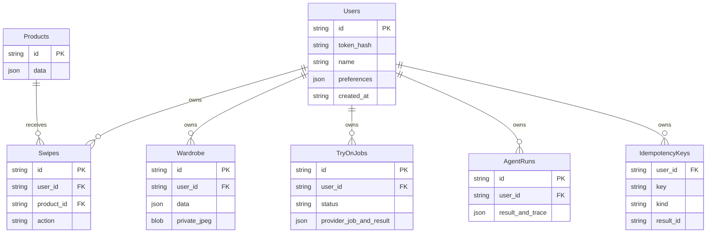

# ALLURÉ — Backend blueprint for app and website

**Shared backend:** FastAPI, Python 3.12. **Local base:** http://127.0.0.1:8766. **API prefix:** /api/v1. **Request schemas:** /docs and /openapi.json. **Clients:** native SwiftUI iOS 26+ and an independently built website. Both use the same API; neither receives model-provider credentials.

## 1. Whole-system map



The graph shows functional boundaries, not separate microservices. Current implementation is a single application. PostgreSQL migration, a distributed worker, MCP, streaming and embeddings are future work.

## 2. First launch, identity and permissions



- iOS: token in Keychain; use PhotosPicker for selected photos; request when-in-use location only after a user action.
- Website: prototype token can live in memory/sessionStorage; geolocation requires HTTPS or localhost; offer manual city selection.
- Location is not background tracking. Backend rounds coordinates to 2 decimal places, caches weather in process, and does not persist coordinates to the profile.
- Current sessions are unverified prototype identities, not Apple Sign In or production authentication. Token expiration does not currently have a refresh flow. A new session creates a new profile; dislikes persist for the original profile, not across unrelated new sessions.

## 3. Style understanding and preference learning



Dislike filtering applies to new feed results even with include_seen=true, daily catalogue outfits, shopping results, saved results and agent catalogue/search tools. Dismissal identity uses available product/variant attributes rather than merchant URL or price. It cannot guarantee identifying every reworded duplicate without reliable identifiers. Other users are unaffected. Similar alternatives are allowed; a left swipe does not ban a whole style.

Current outfit completion uses preferences and category diversity. Full colour-pair, silhouette-balance and occasion scoring remain future work. Live shopping attributes remain unknown when not supplied; do not advertise a complete visual ranking model for those listings.

## 4. Daily weather and owned wardrobe



**Current distinction:** /stylist/daily ranks the shared catalogue, while /wardrobe/outfits ranks only owned garments. Automatic weather-aware mixing of private wardrobe and live shopping is not implemented. Wardrobe images have a separate authenticated GET endpoint; do not expose them as public URLs. Wardrobe labels are manually entered in the current app.

Daily greetings are deterministic copy grounded in forecast data. Hair advice is model-generated. Keep those descriptions accurate. Daily precipitation probability is not an hourly guarantee that it will rain.

## 5. Shopping agent and evidence



Available tools: retrieve_style_profile, retrieve_wardrobe, search_demo_catalogue, search_products, get_local_weather, compare_product_offers, recommend_outfit_items. No purchasing or checkout tool exists. Agent can fall back to explicitly fictional fixtures when shopping is unavailable; it must not invent prices or stock.

Reasoning and vision are separate config roles: LLM_PROVIDER=ollama/gemini and VISION_PROVIDER=ollama/gemini. Photos need a model with vision capabilities. Ollama chat models do not replace weather/search/try-on services.

Product matching requires strong identifier evidence plus matching size and colour for exact_verified_match. probable_match, similar_alternative and unrelated remain separate. Price comparison excludes demo products, unknown currencies and different currencies, and clearly states missing shipping. “Verified” concerns supplied attribute consistency, not independent merchant authentication.

## 6. Virtual try-on state machine



POST /tryon returns HTTP 202 plus job_id. Frontend polls GET /tryon/{job_id} approximately every 3 seconds and stops on completed/failed. Reuse Idempotency-Key on a retry of the same submission; use a new key for a distinct action. The backend never retries a paid POST automatically. Only transient in-process submission is implemented; this is not a distributed job queue. Provider IDs persist; jobs with IDs can resume status polling after restart. Current app polling can be cancelled on closing the fitting room; the provider job may still run and incur usage.

The result is an AI appearance preview, not size/fit measurement. No static image substitutes for a real model output.

## 7. Frontend screen-to-endpoint map

| Screen | Endpoints | Required interface states |
|---|---|---|
| Welcome | POST /sessions | name entry, connecting, validation/network error |
| Today | GET /me; GET /locations/search; POST /stylist/daily | location opt-in, denied/manual fallback, weather loading/error, outfit, demo label |
| Discover | GET /recommendations; POST /swipes | card, like/save/dismiss buttons and gestures, persistence failure, exhausted feed |
| Saved | GET /saved | loading, list, empty |
| Wardrobe | POST/GET /wardrobe; GET /wardrobe/{id}/image; DELETE /wardrobe/{id} | selected-photo preview, upload disclosure, adding, private image, deletion |
| Owned outfit | POST /wardrobe/outfits | insufficient garments, partial outfit, ranked result |
| Stylist chat | POST /agent/shop; GET /agent/runs/{id} | waiting up to 90s, completed/limited/timed_out/unavailable, tool trace and sourced results |
| Search | POST /products/search | loading, real results, no results, provider unavailable, unknown attributes |
| Offer comparison | POST /products/match; POST /prices/compare | exact/probable/similar groups, missing evidence, shipping uncertainty |
| Fitting room | POST /tryon; GET /tryon/{id} | photo selection, consent, queued/processing/completed/failed, unavailable |
| Style profile | PUT /me/preferences; POST /style/analyze | editable choices, exactly five references, analysing, vision unavailable |
| Inspirations | PUT /me/inspirations | name plus user-selected tags, followed list, unfollow, no-endorsement disclosure |
| Hair ideas | POST /stylist/hair | length/texture/goal inputs, thinking, model advice, provider unavailable |
| Colour exploration | POST /style/palette | chosen undertone, explicit opt-in, curated palette; no photo skin analysis |
| Privacy | DELETE /me | explicit delete confirmation; clear client token afterwards |

## 8. Added API requests

All require Authorization: Bearer TOKEN. All JSON responses use the envelope below.

```json
{"success":true,"data":{},"request_id":"req_..."}
```

```json
{"success":false,"error":{"code":"PROVIDER_UNAVAILABLE","message":"..."},"request_id":"req_..."}
```

**PUT /me/inspirations**
```json
{"inspirations":[{"name":"A favourite celebrity","tags":["streetwear","relaxed"]}]}
```
Returns inspirations and a notice. Full replacement of followed inspirations; no scraping of accounts or live celebrity content.

**POST /stylist/hair**
```json
{"length":"medium","texture":"wavy","goal":"Low-maintenance everyday styling"}
```
Returns advice, source:model_generated, photo_analysis:false. Length: short/medium/long. Texture: straight/wavy/curly/coily/unsure.

**POST /wardrobe**: multipart image (JPEG/PNG/WebP), title, category (tops/bottoms/footwear/one-pieces/accessories), color. HTTP 201 returns item:Product. **GET /wardrobe** returns items:Product[]. **GET /wardrobe/{id}/image** returns authenticated image/jpeg bytes, not a JSON envelope. **DELETE /wardrobe/{id}** returns deleted:true. **POST /wardrobe/outfits** takes no body and returns items:Ranked[] plus notice.

Full existing endpoint shapes, curl, React and location examples: [API_CONTRACT.md](API_CONTRACT.md). Model setup: [MODEL_SETUP.md](MODEL_SETUP.md).

## 9. Storage and boundaries



Provider keys are backend-only. Logs and errors must not expose keys, photos or private provider URLs. Shared catalogue contains public/demo products; private wardrobe is queried separately by owner. Local profile deletion removes wardrobe images, swipes, jobs, runs, idempotency records and user record; external provider retention is separate.

## 10. Honest demo scope

Working paths: local Ollama agent, live weather, deterministic ranking, persistent preferences/swipes, private wardrobe CRUD, user-chosen inspiration tags, curated colour palettes. Native SwiftUI UI is implemented and simulator build verified. Backend tests include wardrobe ownership and dismissal propagation.

Provider-dependent: five-image understanding needs a configured vision model; real merchant discovery needs SerpApi; generated try-on needs FASHN. Hair advice uses the configured text model. No provider result should be faked in the UI.

Future: background stylist notifications, camera capture, automatic wardrobe tagging, current celebrity outfit feeds, photo-based complexion analysis, size prediction, robust visual duplicate matching, weather-aware owned-wardrobe integration, production authentication, PostgreSQL migration and hosting. Show these as roadmap rather than completed features.
